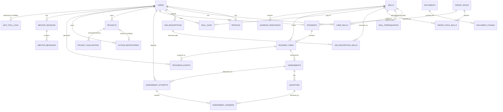
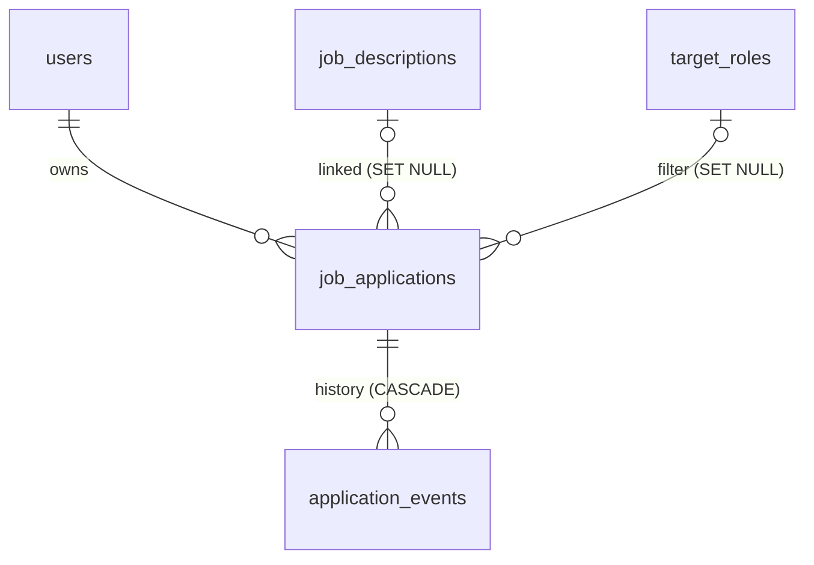
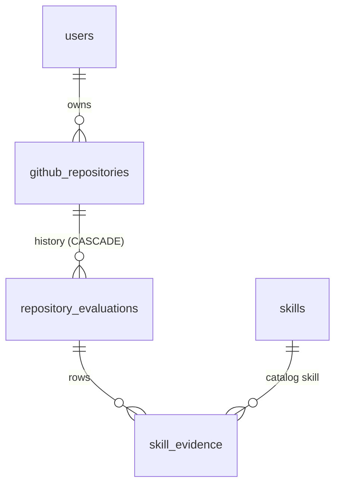
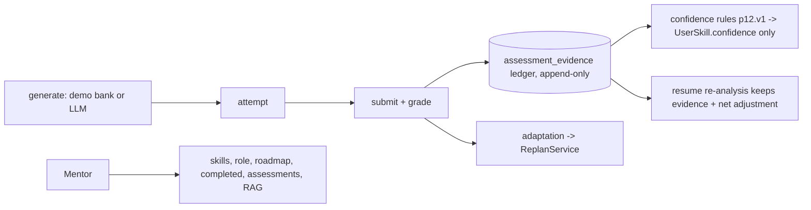
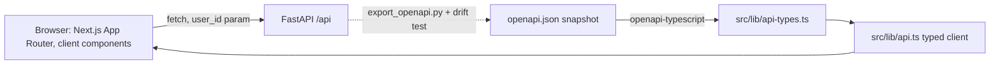

# Architecture detail

Status key used throughout this doc: **implemented** = exists and is
tested right now. **planned** = designed, not yet built — do not assume
it works until its phase's report says so.

## Database architecture — IMPLEMENTED (Phase 2)

25 tables, SQLAlchemy 2.x typed models (`Mapped[...]`/`mapped_column()`),
UUID4-string primary keys, portable enums (`native_enum=False` → VARCHAR +
CHECK constraint, so behavior is identical on SQLite and Postgres), UTC
timestamps, Alembic-managed migrations.

### ERD



*(`SKILL_PREREQUISITES` is `skills ↔ skills`, not a distinct entity —
rendered as attached to `SKILLS` above since Mermaid ER diagrams don't
draw self-joins cleanly.)*

### Skill graph

`skills` is a single shared catalog — a skill is never duplicated as a
free-form string anywhere (not on a user, not on a job description, not
on a roadmap item; everything that needs "Python" points at the same
`skills` row via foreign key). Two things ride on top of that catalog:

- **`skill_prerequisites`** — a self-referencing association
  (`skill_id` requires `prerequisite_skill_id`), enforced against
  self-reference by a `CHECK` constraint. This is what will let the
  roadmap generator (Phase 8) compute a real topological learning order
  instead of an LLM guessing sequence.
- **`user_skills`** — one row per (user, skill), carrying `current_level`
  (a `SkillLevel` enum, not an arbitrary string), a `confidence` float,
  a `source` enum (`resume` / `assessment` / `project` / `github` /
  `manual` / `mentor_evaluation`), and a JSON `evidence` list. The schema
  physically cannot represent "user knows Python" with nothing backing
  it — every claim has a source and, normally, evidence.

### Roadmap data model

`roadmaps` (one per user's active plan) → `roadmap_items` (ordered
steps). Each item has an `item_type` (`skill` / `learning_resource` /
`project` / `assessment`), a unique `order_index` within its roadmap
(enforced by a composite unique constraint — ordering is never ambiguous),
a `status` and `completion_percentage` for tracking, and an advisory
`prerequisite_item_ids` JSON list for cross-item dependencies the
re-planner can consult. `roadmap_items.skill_id` links back to the skill
catalog so an item's real prerequisites can also be derived from
`skill_prerequisites` rather than only what's listed inline.

Nothing here computes a roadmap yet — that's the Roadmap Planner node in
Phase 4/8. Phase 2 only guarantees the shape is there to write into and
that ordering, status, and completion are queryable and consistent.

### Document / chunk separation (RAG prep, not RAG)

`documents` (identity + `content_hash` for dedup-on-reingest) →
`document_chunks` (the actual retrievable text, unique per
`(document_id, chunk_index)`). Deliberately **no vector column**:
`document_chunks.embedding_reference` is a free-form string pointer
(future value shape TBD — a Qdrant point id, or `"pgvector:<table>:<id>"`)
so the Phase 5 decision between pgvector and Qdrant doesn't require
touching this table again. No embeddings are generated in Phase 2.

### Observability

`mcp_tool_logs` — one row per MCP tool call: `run_id` (correlates every
call within one agent run), `server_name`, `tool_name`, `status`
(`success`/`error`/`timeout`), `latency_ms`, sanitized
`input_metadata`/`output_metadata` JSON, `error_type`. No column exists
that could plausibly hold a credential (checked by a structural test —
see Testing below); actual sanitization of what goes into
`input_metadata`/`output_metadata` is enforced in the Phase 3 MCP client
code, not the DB layer.

`progress_events` is a separate, append-only log (no `updated_at`) of
every state change to a roadmap item — completion, skip, quiz
pass/fail, re-plan, streak — which is what the Phase 9 adaptive
re-planner will read instead of only seeing the latest `roadmap_items`
snapshot.

### Cascade behavior (deliberate, not default)

- Deleting a `User` cascades to `profiles`, `user_skills`,
  `job_descriptions`, `skill_gaps`, `roadmaps` (→ `roadmap_items`),
  `projects`, `github_repositories`, `progress_events`,
  `mentor_sessions` (→ `mentor_messages`), `assessment_attempts`
  (→ `assessment_answers`) — all clearly user-owned data.
- Deleting a `Skill` cascades to `user_skills`, `skill_prerequisites`,
  `target_role_skills`, `job_description_skills` referencing it (it's
  meaningless without the skill), but a `roadmap_item.skill_id` or
  `learning_resource.skill_id` reference uses `SET NULL` — deleting a
  skill from the catalog must not silently delete someone's roadmap.
- `github_repositories.project_id` and `mcp_tool_logs.user_id` use
  `SET NULL` — a repo can outlive its project link, a tool log can
  outlive its user.
- Everything above is enforced at the DB level (`ondelete=` on the FK,
  verified against SQLite with `PRAGMA foreign_keys=ON` enabled per
  connection) as well as at the ORM level (`cascade="all, delete-orphan"`
  where Python-side cascade is also wanted).

### SQLite / PostgreSQL compatibility

- IDs: plain `CHAR(36)` UUID4 strings, not a Postgres-only `UUID` type —
  identical on both backends.
- Enums: `native_enum=False` — VARCHAR + CHECK constraint, not Postgres's
  native `ENUM` type, so `alembic downgrade` doesn't leave an orphaned
  Postgres type behind and SQLite (which has no enum type at all) behaves
  identically.
- Migrations run with `render_as_batch=True`, required for SQLite (which
  can't `ALTER TABLE` most things directly — batch mode rebuilds the
  table); a documented no-op on Postgres.
- Verified: every table's `CREATE TABLE` DDL was compiled against the
  PostgreSQL dialect (no live Postgres server needed for this check) with
  zero errors, in addition to the full upgrade/downgrade/upgrade cycle
  actually running against SQLite.

### Testing (Phase 2)

23 tests total (2 from Phase 1, 21 new), covering: DB connectivity,
model creation, `users.email` uniqueness, the skill prerequisite graph
(including the self-reference `CHECK` constraint), user-skill evidence
storage, target-role requirements, roadmap item ordering + its unique
constraint, assessment attempt/answer history, cascade deletes,
`ProjectEvaluation` score-range `CHECK` constraints, progress events,
mentor session/message ordering, MCP tool log success and failure paths
(plus the structural no-secret-columns check), and the Alembic
upgrade → downgrade base → upgrade head cycle against an isolated temp
SQLite file. All model/DB tests run against a fresh in-memory SQLite
database per test — the developer's real `pathforge.db` is never
touched by the test suite.

---

## Agent orchestrator + MCP client — IMPLEMENTED (Phase 4)

The first real agent: a bounded, single-pass pipeline — not yet the full
multi-node graph sketched in Phase 1's original design doc (that richer
shape, with Skill Gap Analysis / Roadmap Generation / etc. as distinct
nodes, is still the target once those phases exist; Phase 4 deliberately
implements only what those later nodes will need underneath: real tool
access via MCP, bounded execution, and a persisted audit trail).

```
FastAPI (POST /api/agent/run)
   ↓
AgentOrchestrator.run(state)
   ↓
Planning / Tool Selection  (LLMProvider.plan)
   ↓
MCP Execution  (MCPClientManager.call_tool, per selected tool, bounded)
   ↓
Result Aggregation  (ToolCallRecord list on AgentState, MCPToolLog rows)
   ↓
Response Generation  (LLMProvider.synthesize)
   ↓
build_agent_response(state) -> AgentResponse (API-facing, never raw state)
```

### MCP client (`apps/api/app/agent/mcp_client.py`)

The only place in `apps/api` that speaks the MCP protocol —
`MCPClientManager` wraps the official SDK's `stdio_client` +
`ClientSession`. Connects to all three Phase 3 servers as real stdio
subprocesses **once**, at FastAPI startup (`app/main.py`'s `lifespan`),
kept open for the process lifetime, closed cleanly at shutdown. Per-
request connect/disconnect would also work but pays a subprocess-spawn
cost on every single request for no benefit.

- **Server configuration** (`app/agent/mcp_config.py`): trusted
  application config only — read from environment variables at process
  startup, never from a user request (letting user input reach a
  subprocess command/args would be a command-injection vector). Server
  paths are computed relative to this repo's own layout
  (`apps/api/app/agent/mcp_config.py` → `../../../../mcp-servers/<name>/server.py`),
  never a hardcoded machine-specific absolute path. Default `command` is
  `sys.executable` — the same interpreter running FastAPI — because
  `apps/api/requirements.txt` now includes `mcp`, `httpx`, and `pydantic`,
  everything every `mcp-servers/*/server.py` needs; override per-server via
  `MCP_<NAME>_COMMAND`/`MCP_<NAME>_ARGS`/`MCP_<NAME>_TIMEOUT_SECONDS` env
  vars to point at a different interpreter (a dedicated venv, a
  docker-compose service) without touching this code. Each spawned
  server's environment is built explicitly (`DEMO_MODE` mirrored from
  this app's own setting, plus only the specific provider credentials
  that server needs) — never the full parent environment, which would
  leak `DATABASE_URL`/`SECRET_KEY` into a child process that has no use
  for them.
- **Tool discovery**: at connect time, `list_tools()` is called against
  every connected server; results become `MCPToolDefinition(server_name,
  tool_name, description, input_schema)` entries in an in-memory
  registry. The agent's available-tools list always comes from this
  registry — nothing is hardcoded into a prompt or into the orchestrator.
  If a server fails to connect, its tools are simply absent from the
  registry (logged as a warning) rather than crashing the whole app; a
  reference to a missing tool later surfaces as `ToolNotFoundError`.
- **Tool invocation**: `call_tool()` looks up which connected server owns
  a tool name, calls it through that server's real `ClientSession`, with
  an `asyncio.wait_for` timeout per-server (`MCPServerConfig.timeout_seconds`,
  default 20s) `→ ToolTimeoutError` on timeout, transport failures
  `→ MCPConnectionError`, an MCP-level error result `→ ToolExecutionError`
  with a bounded (500-char) message. `bounded_result_summary()` caps
  any result to 20,000 characters before it's kept in agent state or
  logged — defense in depth on top of whatever bounding the MCP server
  itself already applies (Phase 3).

### Agent state (`apps/api/app/agent/state.py`)

Typed Pydantic model, not an untyped dict: `user_id, user_request,
conversation_context, target_role, identified_skills, gathered_evidence,
tool_calls, tool_results, errors, final_response, status, run_id`.
`target_role`/`identified_skills`/`gathered_evidence` do nothing yet in
Phase 4 — they exist now specifically so Phase 6/7's skill-gap logic
doesn't require a state-shape migration later. `ToolCallRecord` (one per
tool call) mirrors `MCPToolLog`'s columns closely on purpose, making
persistence in `orchestrator.py`'s `_log_tool_call` a near-direct
mapping rather than a translation layer.

### LLM provider abstraction (`apps/api/app/agent/llm/`)

`LLMProvider` ABC with `plan(state, available_tools, max_tool_calls)` and
`synthesize(state)`. Selected by `DEMO_MODE`, same pattern as every
mcp-servers provider factory (`llm/factory.py`):

- **`DemoLLMProvider`** — deterministic, zero-API-key. Keyword/intent
  matching against the request (GitHub/repo → `search_github_repositories`;
  learn/career/skill → `search_technology_requirements` +
  `search_learning_resources`; job/hiring → `search_jobs`; no match →
  `web_search` fallback). Deliberately does **not** call every available
  tool — selection reflects matched intent only, verified by tests.
  `synthesize()` produces a templated summary from actual tool results.
- **`RealLLMProvider`** — implemented against the Anthropic Messages API
  directly over `httpx` (no SDK dependency, consistent with how
  `mcp-servers/*/providers/live.py` talks to GitHub directly). Uses
  native tool-calling: available MCP tools become Claude tool
  definitions, a `plan()` call asks Claude to select ≤`max_tool_calls`
  relevant tools, a second `synthesize()` call turns tool results into
  a final answer. Only `LLM_PROVIDER=anthropic` is implemented
  concretely; `openai` raises `NotImplementedError` with a clear message
  — the abstraction is what makes adding a real second vendor later not
  touch the orchestrator, not a claim that every vendor works today.
  **Not exercised against a live API in this project's test suite** — no
  `LLM_API_KEY` is configured in the reference/CI environment. If
  unconfigured, raises `LLMUnavailableError` with an actionable message
  rather than silently behaving like the demo provider. API key goes
  only in the outgoing `x-api-key` header, never logged or included in
  a raised exception.

### Orchestrator (`apps/api/app/agent/orchestrator.py`)

Single bounded pass — no autonomous loop (explicitly out of scope for
Phase 4). `max_tool_calls` (default 5, `Settings.AGENT_MAX_TOOL_CALLS`)
is enforced twice: the demo provider's own selection logic respects it,
and the orchestrator independently truncates and records a warning if a
plan somehow exceeds it (defense in depth — a future `RealLLMProvider`
misbehaving doesn't bypass the bound). Every tool call, success or
failure, is recorded as a `ToolCallRecord` and persisted to `MCPToolLog`
(Phase 2's observability table) with sanitized `input_metadata`/
`output_metadata` — arguments are capped at 500 chars per string field
before storage, independent of whatever bounding already happened
upstream. A logging failure never breaks the agent run (caught,
rolled back, logged server-side only). Any unexpected exception is
caught at the top level, logged with a full traceback server-side, and
surfaced to the caller as a generic "internal error" message — never a
leaked stack trace or exception text.

### Response contract (`apps/api/app/schemas/agent.py`)

`AgentResponse` (`answer, sources, tools_used, confidence,
follow_up_questions, errors, status`) is the only thing that crosses the
API boundary — `build_agent_response()` derives it from `AgentState`,
which is never returned directly. `tools_used` exposes which tools ran
and whether they succeeded (for explainability) without exposing raw
tool arguments or full result payloads; `sources` carries the bounded
result data actually used to ground the answer.

### API endpoint

`POST /api/agent/run` — `{user_request, user_id?, target_role?}` in,
`AgentResponse` out. No authentication (superseded: see "Phase 12 — Observability, Authentication & Security"); `user_id` is
accepted from the request body only and never used for authorization,
just to attribute `MCPToolLog` rows. Kept under the same `/api` prefix as
`/api/health` for consistency with the existing convention, rather than
introducing a separate `/api/v1` prefix for this one route.

### DEMO_MODE end-to-end flow (verified, not just designed)

```
HTTP POST /api/agent/run
  → FastAPI → AgentOrchestrator.run()
  → DemoLLMProvider.plan() selects tool(s) by intent
  → MCPClientManager.call_tool() → real stdio subprocess
  → real mcp-servers/*/server.py → DemoGitHubProvider (or Search/Learning demo provider)
  → real MCP CallToolResult back through the protocol
  → ToolCallRecord persisted to MCPToolLog
  → DemoLLMProvider.synthesize() → AgentResponse
```

Verified by `tests/test_agent/test_api_agent_endpoint.py` — no MCP
mocking anywhere in that file; `TestClient`'s lifespan actually spawns
the three real server subprocesses.

### Security

- MCP server configuration is trusted app config only (see above) — no
  user-input path can reach a subprocess command or argument.
- Every tool call is timeout-bounded and result-size-bounded (twice: once
  by the MCP server itself, again by `bounded_result_summary`).
- `max_tool_calls` prevents unbounded/runaway tool invocation.
- No API keys, tokens, or `Authorization`/`x-api-key` header values are
  ever logged or included in a raised exception message, in either the
  MCP client layer or `RealLLMProvider`.
- Nothing here executes an arbitrary shell command or an arbitrary MCP
  server — the three servers and their commands come from
  `mcp_config.py`'s fixed name list, never from request data.

### Known limitations

- `RealLLMProvider` is implemented but untested against a live Anthropic
  API in this environment (no key configured) — only `DemoLLMProvider`
  has end-to-end coverage.
- Tool selection (both demo and real) is single-pass — no re-planning
  based on a tool's result within the same request (e.g. using a search
  result to decide to call a second, different tool). That's the
  "autonomous loop" the brief explicitly excludes from Phase 4.
- `conversation_context` exists on `AgentState` but nothing populates or
  reads it yet — multi-turn conversations aren't implemented.

## RAG architecture — IMPLEMENTED (Phase 5)

```
Document ingestion -> DocumentParser -> StructuralChunker
  -> EmbeddingProvider -> VectorStore (Qdrant) -> [Document/DocumentChunk rows in Postgres]
                                                         |
User query -> EmbeddingProvider -> Retriever -> VectorStore.search (+ metadata filters)
                                                         |
                                              RAGContext (build_context) -> future Agent
```

All under `apps/api/app/rag/`, with five swappable abstractions —
`DocumentParser`, `Chunker`, `EmbeddingProvider`, `VectorStore`,
`Retriever` — none hardcoded to one vendor or file format.

### Vector database: Qdrant

Chosen per the brief's preference, with one deliberate twist: rather than
requiring a running Qdrant server even for local dev/tests,
`QdrantVectorStore` uses the **same `qdrant-client` library and the same
Qdrant data structures/search algorithm** in either of two modes:

- **Embedded local mode** (default, `QDRANT_URL` unset):
  `AsyncQdrantClient(path=QDRANT_LOCAL_PATH)` — genuine Qdrant, on-disk,
  zero server process. This is what makes DEMO_MODE and the whole test
  suite work with no external services, without "bypassing the
  architecture" (the brief's explicit requirement) — it's really Qdrant,
  just not over the network. Tests use `path=None` → `:memory:` for a
  fully throwaway store per test.
- **Server mode** (`QDRANT_URL` set, e.g. `http://qdrant:6333` in
  docker-compose): the exact same class talks to a real Qdrant instance
  over HTTP/gRPC instead. Switching modes is a one-variable config
  change — nothing in the ingestion/retrieval code changes.

PostgreSQL (Phase 2's `documents`/`document_chunks` tables) holds
relational metadata and the chunk text itself; **no vector data is ever
stored in Postgres** — `DocumentChunk.embedding_reference` is just a
string pointer (the deterministic Qdrant point ID), exactly as the
Phase 2 schema was designed to allow.

### Document parsing

`DocumentParser` ABC → `PlainTextParser` (paragraph split) and
`MarkdownParser` (a small, dependency-free structural parser: ATX
headings with correct sibling/ancestor tracking, fenced code blocks
preserved verbatim, paragraphs — not a full CommonMark renderer, since
the chunker only needs structure, not HTML). Both produce the same
`ParsedDocument` (a flat list of typed `ParsedBlock`s with a
`heading_path`) — adding PDF later means one new parser implementation,
nothing downstream changes.

### Chunking

`StructuralChunker` works off `ParsedDocument` blocks, not raw
character offsets:

- Paragraphs merge up to `RAG_CHUNK_SIZE_CHARS` (default 1200), but
  **never across a heading-section boundary** even if they'd fit
  together — two different sections are never combined into one chunk.
- A code block is kept **fully intact** whenever it fits in one chunk;
  only split (on line boundaries — never mid-line) as a last resort when
  a single code block alone exceeds `chunk_size`.
- Overlap (`RAG_CHUNK_OVERLAP_CHARS`, default 200) is applied when a
  paragraph or code block must itself be split.
- A trailing chunk smaller than `RAG_MIN_CHUNK_SIZE_CHARS` (default 100)
  is merged into the previous chunk, but only if that previous chunk is
  the same content type and the same section — never merged across a
  section boundary either.
- Every chunk retains `chunk_index`, `heading_path`, and `content_type`
  ("text" vs "code") as metadata.

### Embedding provider

`EmbeddingProvider` ABC, selected by `DEMO_MODE` (`llm`/`mcp-servers`
pattern, again):

- **`DemoEmbeddingProvider`** — the "hashing trick" (feature hashing,
  the same idea as scikit-learn's `HashingVectorizer`): each token hashes
  deterministically into one of `EMBEDDING_DIMENSION` buckets with a
  deterministic sign, buckets accumulate, result is L2-normalized. Same
  text always produces the same vector (required, tested). No external
  call, no API key, and no pretense that one was made — this is weak but
  *real* semantic signal (texts sharing vocabulary score higher than
  unrelated texts, tested), not random noise, which is what actually
  makes retrieval tests meaningful rather than trivially passing.
- **`RealEmbeddingProvider`** — OpenAI's embeddings API directly over
  `httpx` (no SDK dependency, same pattern as `app/agent/llm/real.py`),
  requesting `dimensions=EMBEDDING_DIMENSION` explicitly so the vector
  store's schema is identical regardless of which provider is active.
  **Not exercised against a live API in this project's test suite** — no
  `EMBEDDING_API_KEY` configured in this environment; same honesty as
  every other "real" provider here.

### Vector store operations

`VectorStore` ABC: `ensure_collection`, `upsert`, `delete_by_document_id`,
`search`, `has_point`. Point IDs are **deterministic**:
`uuid5(FIXED_NAMESPACE, f"{document_id}:{chunk_index}")` — re-ingesting
identical content always produces the same point IDs, so Qdrant's own
upsert semantics (overwrite-by-ID) make ingestion naturally idempotent
at the vector layer (tested: upserting the same point 3× yields exactly
one point).

### Document lifecycle / idempotency

`RAGService.ingest_document`:

1. `content_hash = sha256(content)`. An existing `Document` with the
   same hash → **pure no-op** except for `_repair_missing_vectors`
   (checks every chunk's `embedding_reference` against
   `VectorStore.has_point`; re-embeds and re-upserts only what's
   actually missing — covers "chunk exists in Postgres but its vector
   is missing").
2. Same `(title, source)` but a **different** hash → real re-ingestion:
   delete the old document's vectors (`delete_by_document_id`) and
   `DocumentChunk` rows, then rebuild under the same `Document.id`
   (never a second `Document` row for the same identity).
3. Otherwise → a new `Document` row.

This is deliberately a `(title, source)` identity choice (Phase 2's
schema has no separate external-id column) — documented here so it
doesn't look accidental: two ingestions with the same title+source are
treated as "the same document, possibly updated"; a different
title+source is always a new document.

### Retrieval

`Retriever.retrieve(query, top_k, filters)`: embeds the query with the
same provider used for ingestion, calls `VectorStore.search`, returns
`RetrievedChunk` (content, document_id, chunk_id, score, source
metadata). `top_k` is clamped server-side to `RAG_MAX_TOP_K` (default
20) regardless of what's requested — retrieval is never unbounded.

### Metadata filtering

Whatever a caller passes in `IngestRequest.metadata` (e.g. `skill`,
`difficulty`, `resource_type`) is merged directly into each chunk's
vector payload — no separate filter schema invented beyond what's
actually supplied, per the brief's "avoid adding unnecessary metadata."
`SearchRequest.filters` passes straight through to Qdrant's
`FieldCondition`/`MatchValue` filtering (tested: an unmatched filter
value returns zero results, not a fallback to unfiltered).

### Context builder / citations

`build_context()`: relevance-threshold filter → de-duplicate by
`(document_id, chunk_index)` → bound by chunk count → bound by total
characters, **dropping whole chunks rather than truncating one
mid-sentence** once the character budget is spent (tested). Every
included chunk keeps its `title`/`heading_path`/`source` as a citation
header (`"Source: {title} — {heading path}"`) so a future agent can
attribute an answer to a real, retrieved source — never claim
information came from somewhere it wasn't actually retrieved from.

### API endpoints

`POST /api/rag/ingest` (`title, content, source?, document_type,
metadata?`) → `IngestResponse (document_id, chunks_created,
chunks_repaired, reingested)`. `POST /api/rag/search` (`query, top_k?,
filters?`) → `SearchResponse (results, context, sources)`. Both wired
through `RAGService`, which owns the DB session and holds no state of
its own — the vector store (Qdrant client) is opened once at FastAPI
startup (`app/main.py` lifespan) and reused, same reasoning as Phase 4's
MCP client.

### DEMO_MODE end-to-end (verified, not just designed)

```
POST /api/rag/ingest -> RAGService.ingest_document
  -> MarkdownParser/PlainTextParser -> StructuralChunker
  -> DemoEmbeddingProvider.embed() -> QdrantVectorStore (embedded local mode)
  -> Document/DocumentChunk rows committed
POST /api/rag/search -> Retriever -> DemoEmbeddingProvider.embed(query)
  -> QdrantVectorStore.search() -> build_context() -> SearchResponse
```

Verified by `tests/test_rag/test_rag_api_endpoints.py` — real parser,
real chunker, real (embedded) Qdrant, real demo embeddings; zero mocking
of the RAG pipeline anywhere in that file.

### Security / bounds

- Document size (`RAG_MAX_DOCUMENT_CHARS`, default 200k chars), chunk
  count per document (`RAG_MAX_CHUNKS_PER_DOCUMENT`, default 500),
  `top_k` (`RAG_MAX_TOP_K`, default 20), and context size
  (`RAG_MAX_CONTEXT_CHARS`, default 8000) are all enforced — an
  oversized document raises `DocumentTooLargeError` (400) rather than
  silently truncating or hanging.
- Embeddings are generated in batches of 64 texts, never one giant
  unbounded batch call.
- No arbitrary filesystem or URL ingestion — `POST /api/rag/ingest`
  only accepts inline `content` text, never a path or URL to fetch.
- API keys (`EMBEDDING_API_KEY`, `QDRANT_API_KEY`) are never logged or
  included in a raised exception message.
- Structured logging around ingestion (chunk count, duration) and
  repair (count repaired) uses Python's standard `logging` — no new
  duplicate observability system; this reuses the same `logging`
  approach as the agent orchestrator, not the DB-backed `MCPToolLog`
  table (that table is specifically for MCP tool calls).

### Known limitations

- `RealEmbeddingProvider` untested against a live OpenAI API (no key
  configured in this environment).
- Demo embeddings (feature hashing) are real but weak semantic signal —
  good enough to prove the pipeline discriminates on content, nowhere
  near a trained embedding model's retrieval quality.
- No reranking step implemented (the brief listed it as optional —
  `"if available"`); `build_context`'s relevance threshold is the only
  quality gate on results today.
- Document identity for re-ingestion is `(title, source)` — two
  genuinely different documents that happen to share both would
  collide; there's no separate stable external-id field in the current
  schema.

## Resume analyzer — IMPLEMENTED (Phase 6)

```
Resume input (file or text) -> ResumeParser -> Section detection
  -> ResumeExtractor (demo: rule-based / real: LLM) -> RawExtraction
  -> SkillNormalizer (against the Phase 2 Skill catalog)
  -> evidence.infer_proficiency() -> SkillEvidence[]
  -> persistence (Document/DocumentChunk + UserSkill)
  -> ResumeAnalysis (API response)
```

All under `apps/api/app/resume/`. The core discipline: every stage
produces or consumes a validated Pydantic model — `RawExtraction` before
normalization, `ResumeAnalysis` after — never free-form LLM text passed
straight through to the caller.

### Parsers

`ResumeParser` ABC → `TextResumeParser`, `MarkdownResumeParser` (reuses
Phase 5's `MarkdownParser` structural parser rather than writing a
second one — flattens its blocks back to heading-preserving plain text),
`PDFResumeParser` (via `pypdf`, a mature pure-Python library with no
system dependencies). No OCR: a PDF with no extractable text layer (a
scanned image) returns an empty-but-valid result with a clear warning
(`"No extractable text was found..."`) rather than pretending extraction
succeeded; a genuinely corrupt/unreadable PDF raises
`ResumeParsingFailedError` instead — the two cases are deliberately
distinguished (tested).

### Section detection (`app/resume/sections.py`)

Line-based heuristic, not tied to one template: a fixed map of known
heading variants ("Skills"/"Technical Skills"/"SKILLS" all → the
`skills` canonical key; similarly for summary/experience/education/
projects/certifications/achievements/publications/awards) plus a
fallback for unrecognized headings (strict ALL-CAPS short lines only —
deliberately **not** title-case, which false-positived constantly on
names, addresses, and degree lines like "B.Sc Computer Science" during
development; fixed before shipping). An unrecognized but heading-shaped
line is preserved under its own key, never discarded, per the brief's
"do not assume one fixed resume template."

### Extraction pipeline

`ResumeExtractor` ABC, selected by `DEMO_MODE` — same pattern as every
other provider in this codebase:

- **`DemoResumeExtractor`** — pure regex/heuristic extraction, zero LLM
  calls. Contact info (email/phone/URL regex), skills (comma/newline
  split of the Skills section, tagged `explicit_mention`), a fixed
  ~50-term technology vocabulary scanned against experience/project text
  (tagged `work_experience`/`demonstrated_usage` respectively — real
  string matching, not the LLM inventing anything), experience/project/
  education blocks split on blank lines with date-range and degree/
  institution regexes, certifications one-per-line. Two real bugs were
  caught and fixed while building this: a date regex spanning newlines
  fused unrelated lines together, and the institution parser captured an
  entire "degree, institution" line instead of just the institution
  segment — both covered by tests now.
- **`RealResumeExtractor`** — reuses `app.agent.llm.base.LLMProvider`
  directly (no second LLM abstraction, per the brief's explicit
  instruction) via its `generate_structured` method (added in this
  phase — forced tool-calling against `RawExtraction`'s JSON schema,
  Pydantic-validated, with exactly one repair attempt on a validation
  failure before giving up). `DemoLLMProvider.generate_structured`
  deliberately raises `LLMUnavailableError` rather than fabricating —
  demo-mode resume extraction must never go through an LLM at all.
  **Not exercised against a live API** — no `LLM_API_KEY` configured in
  this environment; the two new `generate_structured` code paths are
  tested with a mocked `_post` instead (schema validation success, and
  the one-repair-then-fail path).

### Skill normalization (`app/resume/skill_normalizer.py`)

Resolves an extracted skill name to the **existing** Phase 2 `Skill`
catalog — case-insensitive exact match, a small deliberate synonym map
(`"ML"`/`"Machine Learning"` → `machine-learning`, `"LLM"`/`"GenAI"` →
`llm-genai`, etc., mapped to the slugs the Phase 2 seed data actually
uses), then a slugified fallback. **Never inserts a new `Skill` row** —
an unmatched name is returned as `None` and surfaces in
`ResumeAnalysis.unmatched_skills` as a plain string, never silently
dropped or added to the catalog (tested).

### Evidence & proficiency inference (`app/resume/evidence.py`)

Deliberately conservative, matching the brief's exact example: a single
`explicit_mention` (a bare skills-list entry) alone stays **beginner**
— it never becomes "advanced" just because a real technology name
appeared once (tested as the core scenario). Evidence types are
weighted (`demonstrated_usage` > `work_experience` > `certification` >
`explicit_mention` > `inferred`); reaching **advanced** requires
multiple pieces of evidence across at least two distinct types (e.g. a
skill both listed AND demonstrated in a project). Rule-based evidence
never reaches **expert** — that would overclaim a strength of signal
regex matching can't honestly support. `reasoning` is a human-readable
sentence listing which evidence types contributed, not a black box.

### Database persistence

No new tables — reuses Phase 2's `Document`/`DocumentChunk` (one
`Document` per analysis, `document_type: "resume"` stored in
`document_metadata`; one `DocumentChunk` per detected section, content
= that section's raw text, **no embedding generated** — resumes are
deliberately not pushed into the RAG vector pipeline this phase) and
`UserSkill` (`source: EvidenceSource.RESUME`, `evidence` = a bounded
JSON list of `{type, text, section}`). Re-analyzing the same user's
resume **updates** existing `UserSkill` rows rather than duplicating
them (the `(user_id, skill_id)` unique constraint from Phase 2 makes
this a natural get-or-update, tested). If no `user_id` is supplied, the
full analysis still runs and returns — skill extraction never requires
a user account, only *persisting to a profile* does.

### API endpoint

`POST /api/resume/analyze` — multipart file upload (`file`) **or** a
plain `text` form field (the brief's "text-based testing path"), plus
an optional `user_id` form field. Returns `ResumeAnalyzeResponse`
(status, the full `ResumeAnalysis`, `document_id`, and skill
create/update counts). An unknown `user_id` doesn't fail the request —
it adds a warning and skips persistence, since the extraction itself is
still valid and useful without a matched account.

### Security / privacy

- File size bounded (`RESUME_MAX_UPLOAD_BYTES`, default 5MB) — enforced
  explicitly for uploaded files (which stream past Starlette's inline
  field-size cap); plain-text form submissions additionally hit
  Starlette's own ~1MB default form-field guard first, a real rejection
  from a different layer (both paths tested).
- Extracted text bounded (`RESUME_MAX_TEXT_CHARS`), sections bounded
  (`RESUME_MAX_SECTIONS`), skills/experience/projects each bounded
  (`RESUME_MAX_SKILLS`/`RESUME_MAX_EXPERIENCES`/`RESUME_MAX_PROJECTS`).
- Filenames are sanitized (`os.path.basename`, null-byte stripped)
  before ever being stored as a display label — the service never
  writes an upload to a path derived from the filename in the first
  place (everything is processed in-memory; `pypdf` reads straight from
  bytes, no temp file ever touches disk).
- Logging is metadata-only (parser used, skill/warning counts, duration
  — see `ResumeAnalyzerService.analyze`'s single log line) — raw resume
  text, contact info, and full extracted content are never logged.

### Known limitations

- `RealResumeExtractor` untested against a live LLM API (no key
  configured here).
- The technology-vocabulary scan for project/experience evidence is a
  fixed ~50-term list, not open-ended entity recognition — a real skill
  named outside that list only surfaces via the Skills section itself,
  not from project-description mentions.
- Education field extraction (the subject/major) only catches the
  `"<Degree> in <Field>"` phrasing; `"B.Sc Computer Science"` (no "in")
  leaves `field` as `None` — a known, minor gap in the demo extractor.
- Resumes are not chunked into the RAG vector pipeline this phase, by
  design (explicitly out of scope per the brief) — only relational
  `Document`/`DocumentChunk` rows exist for a resume, no embeddings.

## Job description analyzer + skill gap engine — IMPLEMENTED (Phase 7)

```
JD (text/Markdown) -> JD parser (reuses Phase 6 text/Markdown parsers)
  -> detect_sections -> JobDescriptionExtractor (demo: rules / real: LLM)
  -> RawJDExtraction -> SkillNormalizer (Phase 6, Skill catalog)
  -> requirement_classifier (importance + expected level)
  -> persist JobDescription / JobDescriptionSkill
  -> compare with UserSkill -> gap_engine -> persist SkillGap -> response
```

Code: `apps/api/app/jobs/`; route `POST /api/job-descriptions/analyze`
(`text` or `file`, optional `user_id`, `target_role_id`).

**Deterministic, explainable scoring.** The LLM (real mode) only extracts
mentions; every number below comes from `requirement_classifier.py` and
`gap_engine.py`. DEMO_MODE uses rule-based extraction and makes no network
or LLM call; different JDs yield different results.

- **Importance** = base (2 required / 1 preferred) +1 intensifying wording
  (essential, mandatory, critical, high priority, strong knowledge/experience;
  "must"/"required" excluded to avoid double counting) +1 if named >=2 times
  in the JD +1 if mentioned in responsibilities. >=4 critical, 3 high, 2
  medium, <=1 low.
- **Expected level** (first match): expert/deep expertise/mastery -> expert;
  strong/extensive experience or 5+ years -> advanced; proficient/solid
  experience/working knowledge -> intermediate; familiarity/basic ->
  beginner; <5 years -> intermediate; else required -> intermediate,
  preferred -> beginner. Never expert merely because a skill is required.
- **Match status**: no UserSkill or level none -> MISSING; level below
  expected -> WEAK; confidence < 0.4 -> WEAK (a skill only weakly evidenced,
  e.g. listed once on a resume, is not a full match); else MATCHED. Skills
  absent from the catalog are `unmatched_skills`, never silently "missing".
- **Severity**: importance base (critical 4, high 3, medium 2, low 1) +
  levels short of expected; >=6 critical, >=4 high, >=2 medium, >=1 low.
- **Priority score (0-100)** = requirement weight (required 1.0 / preferred
  0.6) x importance/4 x severity weight (1, .75, .5, .25, 0) x prerequisite
  factor (1 + 0.1 per prerequisite that is also a gap, cap 1.5) x 100.
- **Overall match score (0-100)** = 100 x sum(w x achieved) / sum(w), with
  w = requirement weight (required 2, preferred 1) x importance weight
  (4/3/2/1) and achieved = 1 matched, rank(current)/rank(expected) weak,
  0 missing. This is a skill-match score only, not career readiness.

**Persistence.** No new tables. Migration `4d46cd9740f2` adds columns:
`job_descriptions.analysis_metadata` (and nullable `user_id` for anonymous
analyses), `job_description_skills.criticality/confidence/reasoning`,
`skill_gaps.match_status/severity/importance/confidence/priority_score/
source_job_description_id`. Re-analysis of the same JD text for a user
updates the existing `JobDescription` and replaces its requirement rows;
`SkillGap` is upserted on (user_id, skill_id), and a gap that is now matched
is closed in place (status `closed`), never duplicated or deleted.
`alembic/env.py` now imports `app.models` — previously autogenerate saw an
empty metadata and would have dropped every table.

**Shared code.** The technology vocabulary moved to `app/skill_vocabulary.py`
and is used by both the resume and JD demo extractors.

**Privacy/limits.** Raw JD text is never logged (metadata-only log line);
filenames are sanitized; size/section/skill counts are bounded
(`JD_MAX_*`); no URL fetching. Plain-text form fields over ~1MB are rejected
by Starlette (400) before the 413 check; file uploads return 413.

**Limitations.** Demo extraction recognizes only the shared vocabulary and
only skills listed under qualification/responsibility sections; years of
experience are not tied to a specific skill unless in the same line;
`target_role_id` is validated and recorded but not yet used for scoring; no
PDF JDs. **Phase boundary:** Phase 7 exposes prerequisites per gap but does
not generate a roadmap, timelines or resources (Phase 8).

## Roadmap generation — IMPLEMENTED (Phase 8)

Spec: `docs/phase8_spec.md`. Code: `apps/api/app/roadmap/` (`planner.py` is
pure and DB-free; `service.py` loads data, calls the planner and persists).
No LLM and no migration: it reuses `roadmaps`, `roadmap_items`,
`learning_resources`, with one new setting, `ROADMAP_STUDY_DAYS_PER_WEEK`.

```
open SkillGap rows (status open/in_progress, not matched)
  -> add transitive prerequisites with no UserSkill evidence as foundations
  -> topological order (ready skills by effective priority, then slug)
  -> effort per level step + week scheduling from weekly capacity
  -> attach up to 2 catalog LearningResource rows per skill
  -> archive previous draft/active roadmaps, persist new active roadmap
```

- **Ordering.** Kahn topological sort over the Phase 2 prerequisite graph.
  Effective priority = max of a skill's own `priority_score` and that of
  every transitive dependent, so foundations of an urgent gap are not
  starved. Ties break on slug; output is fully deterministic. A graph cycle
  produces a warning and the affected skills fall back to priority order.
- **Effort.** Minutes to climb into each level: beginner 480, intermediate
  900, advanced 1500, expert 2400, summed over the steps from current to
  target. A gap with no level shortfall (a low-confidence match) gets a
  120-minute evidence-building floor. These are fixed heuristics, not
  learned estimates.
- **Schedule.** Weekly capacity = hours/day x 60 x study days/week;
  `week_number` is the week an item starts. `fits_deadline` compares needed
  calendar days (study days only) with the deadline; a miss adds a warning.
- **Resources.** Only existing `learning_resources` rows (closest difficulty,
  then shortest). Resource items sit inside the skill's time budget and are
  not added to the total. Nothing is invented or fetched.
- **Persistence.** Skill items are `item_type=skill` with
  `prerequisite_item_ids` linking to prerequisite items; resource items link
  to their skill item; `order_index` is sequential and unique per roadmap.
  New roadmap: `status=active`, `generated_by="rules"`.
- **API.** `POST /api/roadmaps/generate`, `GET /api/roadmaps/{id}`,
  `GET /api/roadmaps?user_id=`. Errors: 404 unknown user, 409 no open gaps,
  422 invalid input.

**Limitations.** Pace is not stored on the roadmap, so `GET` returns null
for pace-derived summary fields. `target_role_id` only sets the title. No
progress tracking, adaptive re-planning, assessments, project generation or
web/MCP resource discovery (Phase 9 and later).

## Progress tracking + adaptive re-planning — IMPLEMENTED (Phase 9)

Spec: `docs/phase9_spec.md`. Code: `apps/api/app/roadmap/` (`progress.py`,
`replan.py`, `access.py`, plus `order_for_replan` in `planner.py`). No LLM,
no migration: it uses `roadmap_items`, `progress_events` and two new
`ProgressEventType` values (`item_blocked`, `item_progress_updated`; stored
as VARCHAR, no DB constraint).

- **Progress.** `PATCH /api/roadmaps/{id}/items/{item}/progress` validates a
  transition table (e.g. completed can only be reopened to in-progress;
  blocked cannot jump to completed) and percentages (0 <= p < 100 only with
  `in_progress`). Every change appends a `ProgressEvent`, which is also the
  source of `started_at` / `completed_at`. All items done or skipped ->
  roadmap `completed`; reopening reactivates it; archived roadmaps reject
  changes. Unmet prerequisites produce a warning, not an error.
  Completing an item does **not** touch `UserSkill`: nothing in the skill
  model makes "item completed" evidence of mastery.
- **Ownership.** `access.load_owned_roadmap` is the single entry for all
  Phase 9 operations; an unknown roadmap and another user's roadmap are both
  404, so existence is never leaked. (Phase 8 `GET /roadmaps/{id}` and
  `/generate` are unchanged and not user-scoped.)
- **Re-plan** (`POST /api/roadmaps/{id}/replan`, in place, same roadmap id).
  Completed/skipped items are resolved: they keep status, percentage and
  history and are excluded from scheduling. Remaining effort per item =
  min(stored minutes x (1 - pct), estimate(current UserSkill level -> target
  level)), so progress or a raised proficiency can only shrink it; stored
  estimates are never rewritten, which makes repeated re-plans idempotent.
  Order = Phase 8 topological order with in-progress items first among ready
  ones; blocked items and their transitive dependents are stalled and
  scheduled last (prerequisite-ordered, never dropped, listed in a warning).
  Week numbers for remaining items are relative to the re-plan (week 1 =
  now). `fits_deadline` + warning when remaining days exceed the deadline.
  Each re-plan appends a `roadmap_replanned` event with per-item order/week
  changes, so history is the event trail plus the preserved resolved items.
- **Errors.** 404 unknown/foreign roadmap or item; 409 invalid transition,
  archived roadmap, or nothing left to re-plan; 422 invalid status,
  percentage, hours (0 < h <= 16) or days (1..1825).

**Limitations.** A re-plan never adds new skills or gaps (run a new JD
analysis and generate a new roadmap for that). Plans are not snapshotted;
history lives in `progress_events`. There is no auth yet, so `user_id` is
caller-supplied and ownership checks are only as strong as that input
(real authentication: see the Phase 12 security section). Assessments, mastery inference
and readiness scoring are later phases.

## Job application tracking — IMPLEMENTED (Phase 10)

Spec: `docs/phase10_spec.md`. Code: `apps/api/app/applications/` (`transitions.py`,
`service.py`, `readiness.py`, `schemas.py`), route `app/api/routes/applications.py`,
models `app/models/application.py`. No LLM. One migration (`c8ea5a22f7dc`) adds two tables
and changes no existing one.



- **Data.** `job_applications` stores only tracking state (status, `applied_on`,
  `scheduled_at`, notes, title/company defaulted once from the JD). Requirements and skills
  stay on the linked `JobDescription`. Unique `(user_id, job_description_id)` prevents
  duplicate links; manual applications (no JD) may repeat. `application_events` is append-only.
- **Lifecycle.** `transitions.ALLOWED` is the single transition table; `rejected` and
  `withdrawn` are terminal; same-state and unlisted moves are 409. Entering `applied` sets
  `applied_on`; `scheduled_at` is only valid with `assessment`/`interview`. Every mutation
  and its event commit together and roll back together on failure.
- **Readiness** (`GET /applications/{id}/readiness`). Computed live from the JD's stored
  `JobDescriptionSkill` rows and the user's current `UserSkill` rows with the Phase 7 functions
  (`classify_match`, `compute_severity`, `compute_priority_score`,
  `compute_overall_match_score`) — no second scorer, nothing written. Each skill is labelled
  `measured` (assessment/project/GitHub/mentor evidence), `estimated` (resume/manual) or `none`.
  `status: unavailable` with a reason when no JD is linked/the JD was deleted/it has no
  matched skills. `persisted_gaps_may_be_stale` is true when user skills changed after the
  JD's last analysis wrote anything, because stored `SkillGap` rows (and roadmaps built from
  them) may then differ from the live numbers. Unmatched requirements are listed, not scored.
  Includes the active roadmap's effort-weighted progress (measured). Always carries a
  disclaimer: an internal indicator, not a hiring probability.
- **Ownership.** Every operation loads the application by `(id, user_id)`; unknown and
  foreign ids are both 404. Creating from a JD requires the JD to belong to the user.

**Limitations.** No authentication: `user_id` is caller-supplied, so ownership checks are not
real access control (superseded by the Phase 12 security section). Readiness covers only skills the JD analysis matched to the
catalog, and levels come from `UserSkill` (resume-derived ones are estimates). No reminders,
calendar/email sync or URL fetching. The roadmap reference picks the user's newest active
roadmap, not one tied to this job. The scheduled interview time is a single field.

## GitHub repository evaluator + skill evidence — IMPLEMENTED (Phase 11)

Spec: `docs/phase11_spec.md`. Code: `apps/api/app/repo_evidence/` (`collector.py`, `analysis.py`,
`manifests.py`, `service.py`, `queries.py`, `url.py`), route `app/api/routes/github.py`, models
`app/models/repo_evidence.py`; one migration (`2403840f632b`). One new GitHub MCP tool,
`get_repository_file`. No LLM.



- **MCP boundary.** `RepositoryCollector` calls `get_github_repository`, `get_repository_languages`,
  `get_repository_readme`, `get_repository_structure` (root and `.github/workflows`) and
  `get_repository_file` through `MCPClientManager.call_tool`, validating every result with the API's
  own pydantic models. The API never imports `mcp-servers/*` and never contacts GitHub. Budget: 12 calls,
  <= 5 manifests, <= 2 workflow files. The MCP file tool accepts only allow-listed manifest/CI paths and
  every repo tool validates owner/repo against GitHub's name charset.
- **What is observed.** Metadata, languages, README, root listing, parsed manifests (requirements.txt,
  pyproject.toml, Pipfile, package.json; go.mod/Cargo.toml/pom.xml are noted but not parsed), Dockerfile/
  compose, CI workflow. Signals (`has_tests`, `has_ci`, ...) are facts about that scope only. No code is
  cloned, executed or statically analysed, so nothing is said about code quality, security or architecture.
- **Evidence rules** (deterministic, per row confidence <= 0.7): declared dependency 0.50; language share
  0.35 (>= 10% of bytes) / 0.45 (>= 40%); Dockerfile/compose or CI workflow 0.50; whole-word README mention
  0.20. Per-skill aggregate = min(0.7, best row + 0.05 per extra evidence type). Each row carries a
  type-specific limitation, an excerpt <= 300 chars, `data_source` and `evaluated_at`. Technology names
  resolve through `SkillNormalizer`; unknown names/languages are reported, never inserted as skills.
- **Separation from proficiency.** `skill_evidence` is its own table; the service never writes
  `UserSkill`, `SkillGap` or roadmaps (asserted by tests). Re-evaluating the same repository reuses the
  `github_repositories` row (unique `(user_id, github_url)`, case-insensitive) and appends a new evaluation;
  only each repository's latest evaluation feeds listings and readiness.
- **Readiness integration.** `ReadinessSkill.github_evidence` lists latest evidence per required skill;
  a warning names skills that have repository evidence but a missing/weak recorded level. The Phase 7
  score, status, severity and counts are unchanged (tested).
- **Errors.** Fixed messages only; upstream text and tokens are never echoed or logged: 404 unknown/private
  repository or foreign evaluation, 429 rate limit, 502 unreachable/malformed, 503 GitHub MCP server
  missing, 422 invalid URL. Optional parts that fail (README, structure, a malformed manifest) become
  limitations; only metadata failure aborts and nothing is persisted on abort.

**Limitations.** Public repositories only; no auth, so `user_id` is caller-supplied and ownership checks
are not access control (superseded by the Phase 12 security section). Live GitHub mode is implemented and tested with mocked HTTP but was not
exercised against live GitHub. Evidence shows what a repository uses, not that this user wrote it (forks
are flagged); only the root listing is read, so nested manifests/tests are not seen. The package-to-skill
map and parsers cover common Python/JS ecosystems only. Demo-mode evidence describes fixture data.

## Assessments + mentor — IMPLEMENTED (Phase 12)

Spec: `docs/phase12_spec.md`. Code: `apps/api/app/assessments/` (`bank`, `generator`, `grading`, `rules`,
`adaptation`, `service`, `access`, `schemas`) and `apps/api/app/mentor/` (`intent`, `context`, `service`, `access`);
routes `assessments.py`, `mentor.py`; model `AssessmentEvidence`; migration `9d9aee6c6dc9`.



- **Key boundary.** Stored `expected_answer`/`evaluation_rubric` are read only inside grading; response schemas have
  no such fields. **Evidence** is a separate table so resume re-analysis cannot overwrite it.
- **Confidence-only.** The applied delta is deterministic (see README); level and source are never written.
- **Adaptation** writes ProgressEvents (`source="assessment_adaptation"`) and reuses Phase 9 re-planning.
- **Mentor** grounds answers in retrieved chunks; citations are validated against the retrieved set; missing
  context is always disclosed. Ownership checks use caller-supplied `user_id` and are not access control.

## Frontend dashboard — IMPLEMENTED (Phase 13)

Spec: `docs/phase13_spec.md`. Code: `apps/web/src` (`app/` pages, `components/`, `lib/`).



- **Contract-first client.** Types are generated from a committed OpenAPI snapshot; a backend test fails on drift.
  Fields with server defaults are optional in the schema but always serialized, so the client uses a `Strict<>` view.
- **One fetch wrapper** (`ApiError`, readable FastAPI detail, "cannot reach API" message); every page has loading,
  empty and error states. No secrets in the browser; only `NEXT_PUBLIC_API_URL`.
- **Honest UI.** Demo/live badge from `/api/health`; assessment source labels and grading notices; coding answers
  marked rubric-only and not executed; mentor `answer_source`, citations and missing context; GitHub `data_source`
  and limitations; readiness stale warnings and disclaimers.
- **Answer keys** never reach the UI: the contract has no such fields and a test greps the web source and snapshot.
- **No authentication** (superseded by the Phase 12 security section): the active user id is typed in and kept in `localStorage` (try/catch guarded).

## MCP architecture — IMPLEMENTED (Phase 3)

Three independent MCP servers, each built on the official MCP Python SDK
(`mcp` package). The installed SDK is 2.x, where the class earlier SDK
versions called `FastMCP` was renamed `MCPServer` (`mcp.server.mcpserver.MCPServer`)
— same decorator-based `@mcp.tool()` API, new import path. Documented in
each server's `server.py` docstring so this doesn't trip up whoever reads
it next.

```
mcp-servers/
├── common/          shared: DEMO_MODE + limits (config.py), secret-safe
│                     structured errors (errors.py)
├── github/           server.py, client.py, providers/{base,demo,live}.py,
│                     schemas.py, tests/ (14 tests), README.md
├── search/           server.py, providers/{base,demo,real}.py,
│                     schemas.py, tests/ (9 tests), README.md
└── learning-resources/  same shape as search/, tests/ (9 tests), README.md
```

`common/` is a deliberate addition beyond the brief's suggested
per-server layout: DEMO_MODE philosophy and secret-safe error handling
are identical across all three servers, and duplicating that logic three
times would mean three places to get it wrong. Each server does an
explicit `sys.path.insert()` (see module docstrings) rather than relying
on package installation, since `learning-resources/`'s hyphen makes it
unimportable as a dotted Python package — servers are meant to run and
be tested as standalone directories, not installed as a package.

### Transport

**stdio**, the practical choice for local development today (`python
server.py` per server, or spawned as a subprocess by a future MCP
client). Every server's `mcp.run(...)` call is one line
(`mcp.run(transport="stdio")`); switching to `transport="streamable-http"`
for a containerized deployment (Phase 13) requires changing only that
line — nothing about tool definitions, providers, or schemas depends on
the transport.

### Tool catalog

**GitHub** (`pathforge-github-mcp`): `search_github_repositories`,
`get_github_repository`, `get_repository_languages`,
`get_repository_structure`, `get_repository_readme`, `get_repository_file` (Phase 11; allow-listed
manifest/CI paths only).

**Search** (`pathforge-search-mcp`): `web_search`, `search_jobs`,
`search_technology_requirements`.

**Learning Resources** (`pathforge-learning-resources-mcp`):
`search_learning_resources`, `get_learning_resource`, `search_courses`,
`search_documentation`.

Full input/output schemas and example calls: each server's `schemas.py`
and `README.md`. Every tool description is written for an LLM agent
(states *when* to use the tool, not just what it does) — see any
`server.py` for examples.

### Provider abstraction

Every server follows the same shape: a `providers/base.py` ABC, a
`providers/demo.py` (deterministic, zero-credential, DEMO_MODE data), and
a real-data implementation (`providers/live.py` for GitHub — a genuine
GitHub REST API client; `providers/real.py` for Search and Learning
Resources — a generic "BYO backend" HTTP contract, since no single
vendor is canonical for either). Tool functions in every `server.py`
depend only on the abstract provider interface; `get_provider()` picks
demo vs. real based on `DEMO_MODE` and nothing else touches that choice.

### DEMO_MODE behavior

Reuses the exact philosophy from `apps/api`'s `Settings.DEMO_MODE`
(Phase 1/2) rather than a second mocking system — read live from the
`DEMO_MODE` env var by each server's `common/config.py`.

- `DEMO_MODE=true` (default): every tool runs with zero external
  credentials, returning small, deterministic, structurally-identical-to-real
  data, every response explicitly tagged `"source": "demo"`.
- `DEMO_MODE=false`: GitHub falls back to real (unauthenticated is fine,
  just lower rate limit); Search and Learning Resources require their
  respective `*_PROVIDER_BASE_URL` to be configured, or raise
  `ProviderUnavailableError` with an actionable message — never a silent
  fallback to fake data pretending to be live.

### Security

- Bounded everywhere: `max_results` is server-side clamped
  (`common/config.py`: default 10, hard cap 25) regardless of what a
  caller requests; GitHub README/structure responses carry an explicit
  `truncated` flag instead of growing unbounded.
- No arbitrary-URL fetching tool exists on any server — only fixed,
  documented endpoint shapes.
- Every bounded HTTP call uses `HTTP_TIMEOUT_SECONDS` (default 10s).
- Tokens/API keys go only in the outgoing `Authorization` header, never
  logged, never in a raised exception's message — verified by a
  dedicated test (`github/tests/test_client_and_live_provider.py::test_token_never_appears_in_raised_error_message`)
  that confirms the header was sent but doesn't leak back on failure.
- `common/errors.ToolError` subclasses the MCP SDK's own `ToolError`
  deliberately: the SDK only forwards an exception's message to the
  client when it recognizes the exception as an intentional tool error;
  anything else (a real bug) has its message suppressed from the client
  by default. This is what lets `InvalidArgumentsError("'query' must not
  be empty")` reach the caller while an unexpected internal exception
  doesn't leak internals.

### Testing

32 tests total, all offline (no live external API calls). Two kinds:

1. **Protocol-level** — `mcp.Client` connected to the real `MCPServer`
   instance over in-memory transport (`mcp.shared.memory`, wrapped by
   `mcp.Client`). This exercises actual MCP tool discovery
   (`list_tools`) and invocation (`call_tool`) through the SDK's real
   dispatch path, not by calling Python functions directly — including
   verifying error responses come back as `is_error=True` with a safe
   message rather than a raised exception or a leaked stack trace.
2. **Provider-level** (GitHub only, where a real HTTP integration
   exists) — `httpx.MockTransport` intercepts outgoing requests so
   `GitHubClient`/`LiveGitHubProvider` are tested against realistic
   GitHub API responses (200, 404, 403-rate-limited, malformed) with
   zero network access.

### MCP client contract (for the future FastAPI agent — Phase 4, NOT built yet)

The Phase 4 agent must talk to these servers *only* through an MCP
client — never by importing `mcp-servers/*` implementation functions
directly into `apps/api`. That boundary is what makes the "the agent
dynamically selects MCP tools" story true rather than decorative.

| Server | Process name | Transport | Tools | DEMO_MODE |
|---|---|---|---|---|
| GitHub | `pathforge-github-mcp` | stdio (→ streamable-http later) | 5, listed above | `DemoGitHubProvider` / `LiveGitHubProvider` |
| Search | `pathforge-search-mcp` | stdio | 3, listed above | `DemoSearchProvider` / `RealSearchProvider` |
| Learning Resources | `pathforge-learning-resources-mcp` | stdio | 4, listed above | `DemoLearningResourceProvider` / `RealLearningResourceProvider` |

Expected Phase 4 shape: the agent's MCP client spawns each server as a
subprocess over stdio (or connects over HTTP once servers run as
docker-compose services), calls `list_tools()` once to discover the
catalog above, and calls `call_tool(name, arguments)` per the schemas in
each server's `schemas.py`. Every call should be logged to the
`mcp_tool_logs` table (Phase 2) with `server_name`/`tool_name` matching
this table, `status` from `MCPToolStatus`, and sanitized
`input_metadata`/`output_metadata` — never the raw arguments if they
could contain user PII beyond what's needed for debugging, and never
credentials (none of these tools accept a credential as an argument in
the first place, so this is mostly about not logging full README/search
result bodies verbatim).


## Phase 12 — Observability, Authentication & Security

Full spec: `docs/phase12_security_spec.md`. No database migration (the `users` table already had `password_hash`/`is_active`).

- **Identity.** `app/security/`: `passwords` (scrypt, constant-time verify), `tokens` (HS256 JWT with `sub/iat/exp/iss/aud/jti`,
  algorithm pinned), `deps` (`get_current_user` re-loads the user and requires `is_active`; `require_admin`;
  `enforce_user_binding` router dependency that rejects a `user_id` in query/JSON/form that differs from the token's user),
  `throttle` (in-memory failed-login limiter), `validation` (startup refusal of unsafe staging/production settings).
- **Routing.** Public: health, readiness, auth register/login, docs/OpenAPI, metrics (own token rule). Everything else is included
  with `enforce_user_binding`; handlers call `auth.bind(user_id)`; `GET /roadmaps/{id}` gained an owner check.
- **Observability.** `app/observability/`: pure-ASGI middleware (request id, security headers, body-size 413, generic 500, access log
  with route template only, metrics), redacting text/JSON log formatters, in-process Prometheus metrics. No new dependencies.
- **Frontend.** `lib/auth.ts` (sessionStorage session), `/login`, Authorization header in `lib/api.ts`, 401 → clear + redirect.
- **Limitations.** Non-revocable JWTs, per-process throttle/metrics, sessionStorage token, allow-list admin, open registration,
  no email verification/reset. `AUTH_REQUIRED=false` is local/test only.
